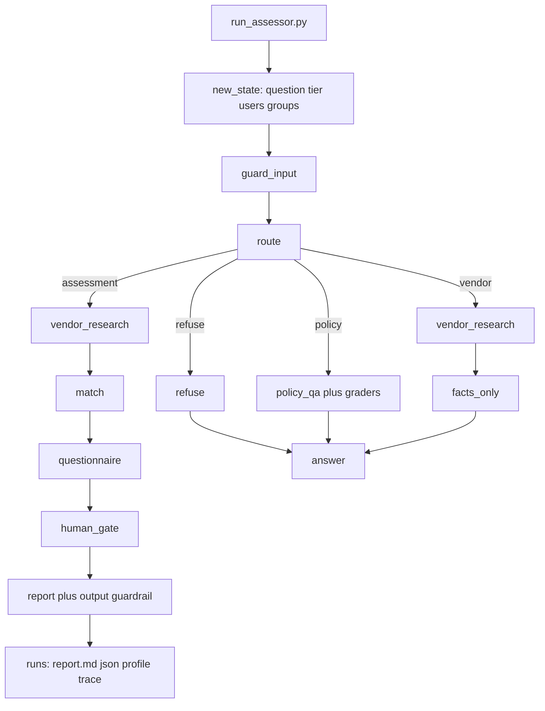

# Code flow — AI Vendor Risk Assessor

Reference for how a single run moves through the codebase.

## Entry

[`run_assessor.py`](../run_assessor.py):

1. Parse CLI (question, `--tier`, `--users`, `--groups`, `--vendor`, `--engine`, …)
2. Load settings from `.env` via [`assessor/config.py`](../assessor/config.py)
3. Create `Tracer` + `Budget` ([`assessor/tracing.py`](../assessor/tracing.py))
4. Build shared `state` with `new_state(...)`
5. Call `Pipeline.run(state)` in [`assessor/graph.py`](../assessor/graph.py)
6. Print `state["answer"]`; assessment runs also write under `runs/<id>-assess/`

The same node functions run as **plain Python** (`run_plain`) or **LangGraph** (`build_langgraph`) when installed.

## Pipeline diagram

## Steps

### 1. `guard_input` — [`assessor/guardrails.py`](../assessor/guardrails.py)

- Redact sensitive input
- Intent check; bad intent forces route `refuse`

### 2. `route` — [`assessor/router.py`](../assessor/router.py)

Classifies the question into one of four routes (rule-based mock offline; LLM router is Milestone 3):

| Route | Meaning |
|---|---|
| `policy` | What do *our* policies say? |
| `vendor` | Factual question about a vendor (no verdict) |
| `assessment` | Can/may we *use* this tool? Policy + research + match |
| `refuse` | Out of scope, or asking the AI to approve |

Also detects / attaches the vendor name.

### 3. Branch outcomes

| Route | Nodes | Result |
|---|---|---|
| **policy** | `policy_qa` ([`policy_rag.py`](../assessor/policy_rag.py) + [`graders.py`](../assessor/graders.py)) | Answer with clause citations |
| **vendor** | `vendor_research` → `facts_only` | Public facts only |
| **assessment** | research → match → questionnaire → human_gate → report | Full review file |
| **refuse** | `refuse` | Short refusal |

### 4. Full assessment path (main product)

1. **`vendor_research`** — [`assessor/vendor_research.py`](../assessor/vendor_research.py)  
   Offline: corpus → identity → quarantine → `mock_claims` → merge.  
   Live (M2): Plan Creator/Reviewer → parallel fetch/extract under one Budget → identity gate → quarantine → small-model extract → merge. See [`m2-vendor-research.md`](m2-vendor-research.md).

2. **`match`** — [`assessor/matcher.py`](../assessor/matcher.py) + [`data/requirements.yaml`](../data/requirements.yaml)  
   Deterministic rules × facts → PASS / FAIL / UNKNOWN / NEEDS_REVIEW → overall `BLOCKED` / `CONDITIONAL` / `READY FOR APPROVAL`  
   **The LLM never decides the verdict.**

3. **`questionnaire`** — [`assessor/questionnaire.py`](../assessor/questionnaire.py)  
   Gaps become questions to send the vendor

4. **`human_gate`** — person approve / reject / pending  
   Cannot approve if overall is `BLOCKED`

5. **`report`** — [`assessor/report.py`](../assessor/report.py) + output guardrail  
   Writes `report.md`, `report.json`, `profile.json`, `trace.jsonl`, and optionally `vendor_questions.txt`

## Mental model

- **Router** chooses the path  
- **Policy RAG / vendor research** gather evidence  
- **Matcher** owns requirement verdicts  
- **Human** is the only approver  
- **Trace** records every step for debugging  

## Contracts and data

- Pydantic stage contracts: [`assessor/schemas.py`](../assessor/schemas.py)
- Policy docs + ACL metadata: [`data/policies/`](../data/policies/)
- Machine-checkable rules: [`data/requirements.yaml`](../data/requirements.yaml)
- Fictional vendor web (offline): [`data/vendor_web/corpus.json`](../data/vendor_web/corpus.json)
- Eval gold set: [`data/gold_set.json`](../data/gold_set.json)

## Project rules (do not break)

1. LLM never decides a verdict — `matcher.py` does  
2. UNKNOWN beats a guess; PASS without a URL is a bug  
3. A marketing claim is not evidence (`claimed` vs `documented`)  
4. Identity is a gate before reading a page  
5. Injected / untrusted content never reaches the verdict  
6. Access control lives in retrieval (ACL groups)  
7. Humans approve — the report ends in an approval block  
